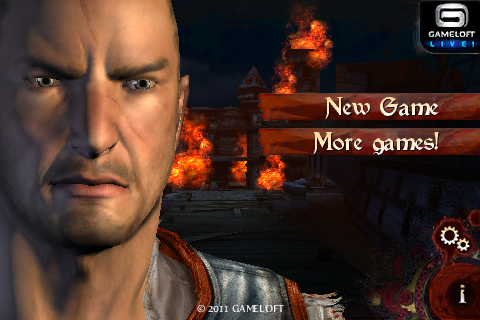
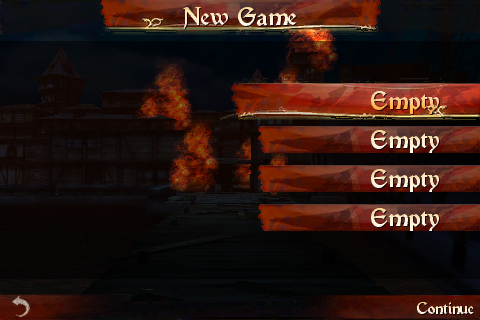
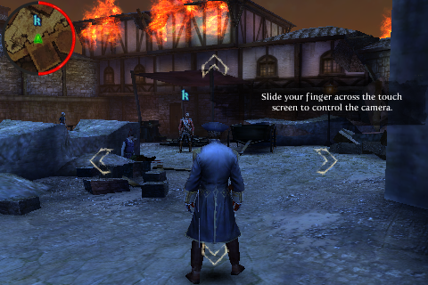

# BackStab menu touch regression

Input: `com.gameloft.BackStab`, version 1.0.0, ARMv7/iOS 3.1.3.

The title screen rendered, but neither of two taps after the complete intro
reached the game's touch handlers. Runtime diagnostics from
[the baseline run](https://github.com/KlugKlugTG/HyperHLE-Reborn/actions/runs/45175380941)
show both taps targeting `substView`, a transparent movie-subtitle overlay
above `EAGLView`.

Static inspection of the guest `MoviePlayer -dealloc` shows it calling
`freeMovie`, then `[super dealloc]`, then `movieSubtitles_reset` and writing
more instance fields. The last method removes/releases the saved subtitle
view. Clearing the freed `isa` caused message dispatch to skip this cleanup;
the baseline logs report `nil isa` for `movieSubtitles_reset` after both movies.

Source commit `ab4afebc` exposes the existing allocator policy as the general
option `--zero-memory-on-alloc`, enabled only through BackStab's bundled
defaults. It preserves freed bytes until reuse without delaying reclamation
or retaining host objects, and still clears weak references. This is a
compatibility setting for invalid legacy guest code, not a new UIKit
hit-testing or modal-presentation rule.

[The fixed runtime run](https://github.com/KlugKlugTG/HyperHLE-Reborn/actions/runs/45180508630)
uses CI-built native ANGLE/EGL, an ES2 guest context and software Vulkan on
Ubuntu ARM64. The second screenshot, after the post-intro title tap, visibly
shows the main menu's **New Game** and **More games!** buttons:

Both recorded taps target `EAGLView`; no `substView` remains in the window's
child list and no `movieSubtitles_reset` nil-isa warning occurs. The second
tap in that first run was outside the New Game button, so it does not prove
gameplay progression.

[The New Game interaction run](https://github.com/KlugKlugTG/HyperHLE-Reborn/actions/runs/45181462796)
taps the visible button at window fractions `(0.78, 0.33)` and opens the
save-slot selection screen. Both title and New Game taps reach `EAGLView`:

The runtime logs still contain existing filesystem directory-read warnings
and early ES2 `GL_INVALID_OPERATION` diagnostics. Passing the touch-target
gate does not mean every guest API error is resolved.

[The first-level run](https://github.com/KlugKlugTG/HyperHLE-Reborn/actions/runs/45182404870)
taps Continue on the highlighted empty save slot at `(0.92, 0.96)`. It
passes through the Occupied New Bristol loading screen and reaches the
rendered first level with its camera tutorial:

The user subsequently confirmed that menu input/gameplay works on their
device, and reported flickering only during the intro movies. A separate
presentation correction is being validated for that issue.

[The source validation run](https://github.com/KlugKlugTG/HyperHLE-Reborn/actions/runs/45179169027)
passes 548 Rust tests and the full TestApp suite. The allocator regression
covers both policies, freed cleanup fields, weak-reference clearing,
immediate reclamation and zeroed allocation reuse.

[The Android build](https://github.com/KlugKlugTG/HyperHLE-Reborn/actions/runs/45179338328)
successfully produces `HyperHLE_Android_AArch64`. The APK contains both the
new policy and `com.gameloft.BackStab: --zero-memory-on-alloc`. Android/Mali
touch and gameplay still require device validation; software CI is not a
Helio G99 device test. All compilation and game execution ran in GitHub CI.
